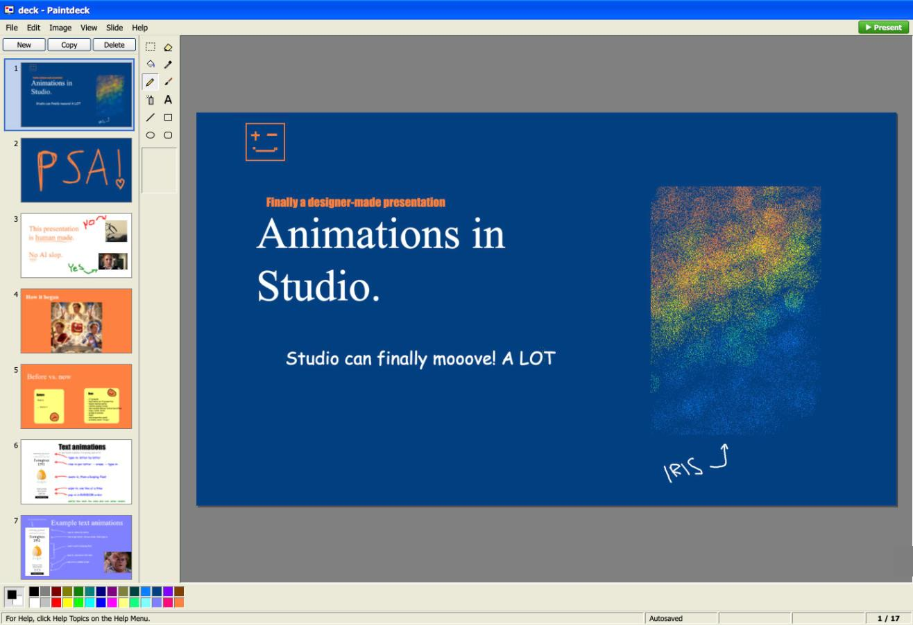
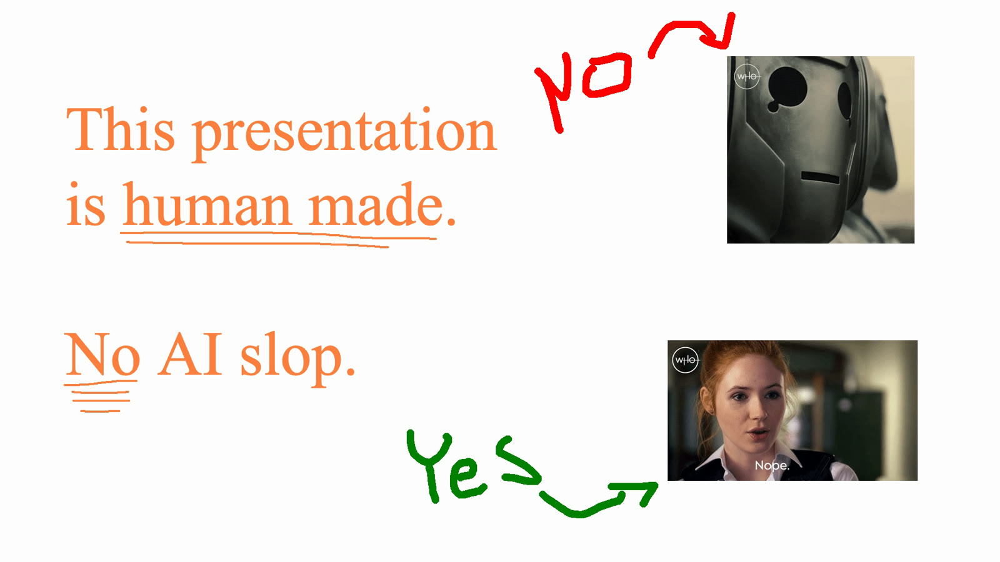

# Paintdeck

MS Paint (XP), but every slide is its own 1920×1080 canvas, with a fullscreen presenter and animated GIFs that keep moving.



Made for a talk where the slides had to look unmistakably human-made. Draw your slides with the pencil, the spray can and the paint bucket, drop in GIFs, and present fullscreen. The build is a single HTML file that runs offline from a USB stick.



More about it: [lindmarker.se/projects/paintdeck](https://lindmarker.se/projects/paintdeck/)

## Run

```sh
bun install
bun run dev        # http://localhost:5199
```

## Build and open offline

```sh
bun run build      # typecheck + single self-contained file
open dist/index.html
```

`dist/index.html` has every script and style inlined. It runs from `file://` with wifi off; copy it to a USB stick together with your `.paintdeck` file.

Your deck autosaves in the browser (IndexedDB) about a second after every change, and comes back when you reopen the page. That storage belongs to the address the page was opened from: a deck made on `localhost:5199` will not show up in `file:///…/index.html` and the other way round. Pick one (the built file is the safest for the talk) and use **File → Save** to move a deck between them or to another machine.

## Shortcuts

`⌘` on macOS, `Ctrl` elsewhere.

| Action | Keys |
|---|---|
| Undo / redo (per slide) | ⌘Z / ⌘Y or ⌘⇧Z |
| Cut / copy / paste | ⌘X / ⌘C / ⌘V |
| Select all | ⌘A |
| Delete selection or selected GIF | Delete / Backspace |
| Stamp floating image or selection | Enter, or click outside it |
| Deselect / stamp | Esc |
| Save `.paintdeck` / open | ⌘S / ⌘O |
| Duplicate slide | ⌘D |
| Previous / next slide | ⌘↑ / ⌘↓, PageUp / PageDown |
| Present from start / current | F5 / Shift+F5, or ⌘⇧Enter / ⌘Enter |
| Square, circle, 45° line | hold Shift while dragging |
| Draw with secondary colour | right mouse button |
| Copy a selection while moving it | hold ⌘, ⌥ or Ctrl when you start dragging |

While presenting:

| Action | Keys |
|---|---|
| Next | → ↓ Space PageDown Enter, left click |
| Previous | ← ↑ PageUp Backspace, right click |
| Jump to slide N | type N, then Enter |
| Black screen | B (or .) |
| Draw in red | hold D, or tap D to toggle; C clears |
| Exit | Esc (returns to the slide you were on) |

## Tips

- Animated GIFs: drag the `.gif` file onto the canvas or use **Edit → Insert Animated GIF…**. Copying a GIF from a web page usually puts a still image on the clipboard.
- GIFs sit above the paint layer. Select them with the Select tool, drag to move, drag corners to resize (Shift keeps the ratio), right-click for z-order, delete, or "stamp frame into canvas".
- Pasted or dropped images float until you press Enter or click outside; after that they are ordinary pixels you can draw, fill and erase on.
- If the browser refuses fullscreen, the presenter fills the window instead; press any key or click to try fullscreen again, or use ⌃⌘F.
- **File → Export Slides as PNGs** is a backup that any image viewer can show.

## File format

A `.paintdeck` file is a zip with `deck.json`, one PNG per slide in `slides/` and the original GIFs in `gifs/`.
